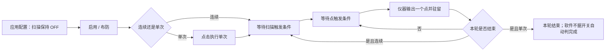

# 鼎阳 SIGLENT SSG 详细使用说明

更新日期：2026-10-27

适用软件：0.7.18 源码及 Windows x64 正式发行版

主要设备：**SSG3021X，普通模拟型号，非 IQE、非 -V**

验证状态：0.7.10 的全项目 269 项通过作为历史记录保留；本轮实际回归、自检与打包证据见[0.7.18 说明](../release/NOTES-0.7.18.md)。尚未连接用户实机验证固件、触发时序和输出波形。v0.7.0 的 USB 问题及普通 C01A 手册复核、幅度单位依据见[专项核对报告](SIGLENT_SSG3021X_AUDIT_20260926_CN.md)。

0.7.10 起，数值输入框和收起的单位下拉框不随鼠标滚轮改值；滚轮用于滚动页面。直接输入、键盘方向键和增减按钮仍可修改数值。

本文按当前界面和驱动编写。实现和维护细节见[鼎阳开发说明](SIGLENT_SSG_DEVELOPMENT_CN.md)，项目历史见[开发日志](DEVELOPMENT_LOG_CN.md)。旧版 PDF 尚未重建，使用本 Markdown 作为鼎阳功能的当前说明。

## 目录

1. [功能范围与型号](#1-功能范围与型号)
2. [安装与连接](#2-安装与连接)
3. [页面、按钮与状态](#3-页面按钮与状态)
4. [固定频率和功率输出](#4-固定频率和功率输出)
5. [扫描参数与两级触发](#5-扫描参数与两级触发)
6. [STEP 扫描实例](#6-step-扫描实例)
7. [LIST 自定义列表](#7-list-自定义列表)
8. [AM、FM、PM 调制](#8-amfmpm-调制)
9. [脉冲调制与 BUS](#9-脉冲调制与-bus)
10. [扫描与调制并用](#10-扫描与调制并用)
11. [参数保存与备份](#11-参数保存与备份)
12. [诊断与故障处理](#12-诊断与故障处理)
13. [虚拟设备与实机验收](#13-虚拟设备与实机验收)
14. [其他型号差异](#14-其他型号差异)
15. [官方资料](#15-官方资料)

## 1. 功能范围与型号

本软件通过 Python / PyVISA / SCPI 控制仪器。扫描点预先配置到 SSG，由仪器执行步进；**不使用 NI 计数器在每次触发时发送下一点频率**。使用 NI-VISA 作为通信驱动，不等于使用 NI 采集卡触发扫描。

### 1.1 SSG3021X 已接入功能

| 功能 | 当前范围 |
| --- | --- |
| 连接 | USB VISA、LAN VISA；读取型号、序列号、固件 |
| 基本输出 | 频率、功率、独立 RF 开关及回读 |
| STEP | 频率、功率、两者联合；线性/对数、锯齿/三角、正向/反向 |
| LIST | 编辑、上传、读取自定义频率/功率/驻留列表 |
| 扫描触发 | 扫描触发和点触发分别选择 AUTO / KEY / BUS / EXT |
| 扫描模式 | 连续、单次；启用与执行单次分别操作 |
| 模拟调制 | AM、FM、PM、单脉冲及调制总开关 |
| 脉冲触发 | AUTO、KEY、BUS、EXT、EGATE；软件 BUS 触发按钮 |
| 诊断 | 状态回读、扫描/调制详细参数、单条 SCPI |
| 本地配置 | 参数自动保存、自定义列表保存、整套配置导入导出 |

普通 SSG3021X 不使用 IQ/ARB 控制，软件不会向它发送 -V 专用的 FM1 或 IQ 查询。完整脉冲串、双脉冲编辑、ARB 上传和完整 IQ 编辑不在本版界面范围。

### 1.2 频率与功率范围

SSG3021X 频率范围为 **9 kHz–2.1 GHz**。功率按当前频率检查：

| 频段 | 本版允许的功率设置 |
| --- | --- |
| 9 kHz ≤ f < 100 kHz | −110 至 +9 dBm |
| 100 kHz ≤ f < 1 MHz | −110 至 +15 dBm |
| 1 MHz ≤ f ≤ 2.1 GHz | −110 至 +20 dBm |

这是设置范围，不等同于保证输出精度的范围，也不保证所有负载条件下达到所设电平。依据见[官方数据手册](https://siglentna.com/download/7543/)。

界面是多型号共用的编辑器，能输入的数值可能比本型号范围大；**真正下发前仍按识别出的型号校验**。超范围会报错，不会自动当成另一个型号处理。

## 2. 安装与连接

### 2.1 软件准备

使用 0.7.10 便携 ZIP 或单文件 EXE 时，无需安装 Python/PyQt6/PyVISA，按[便携说明](../release/README.md)运行即可；实际仪器仍需 VISA 系统驱动。以下安装命令只用于源码运行。

已有程序可以启动时，无需重新安装界面依赖。真实仪器通信需要 Python 3.10+、PyQt6、PyVISA，以及可用的 VISA 运行库。当前后端使用 `pyvisa.ResourceManager()` 的默认 VISA 实现；Windows 可使用 NI-VISA。

从项目目录安装基本软件及 PyVISA：

```powershell
python -m pip install -e .
python -m pip install PyVISA
```

项目的 `python -m pip install -e ".[instrument]"` 还会安装其他仪器的 Python 依赖。安装 PyVISA 包本身不等于安装了厂商 VISA 运行库。

双击项目内的 `Lab Control Center.exe` 启动。该启动器依赖电脑上的 Python 环境；更新源码后完全退出并重新启动，使新代码生效。

### 2.2 USB 连接

1. 用 USB 线连接仪器的 USB Device 接口与电脑，打开仪器。
2. 首页添加设备，类型选择“鼎阳 SIGLENT SSG”。
3. 名称可填“鼎阳 SSG3021X”，连接方式选择“USB VISA”。
4. 从发现列表选择真实 USB 资源；没有发现时，粘贴 VISA 工具列出的完整资源地址。
5. 保存后打开设备窗口，点击“连接 / 读取身份”。
6. 核对实际型号为 SSG3021X，记录序列号和固件。

不要把包含省略号的 `USB0::...::INSTR` 当作实际地址；地址应来自真实枚举。

### 2.3 LAN 连接

在仪器网络设置中查看实际 IP，保证电脑可以访问。可手工输入：

| 协议 | 地址示例 |
| --- | --- |
| VXI-11 | `TCPIP0::192.168.1.100::inst0::INSTR` |
| Socket | `TCPIP0::192.168.1.100::5025::SOCKET` |

将示例 IP 替换成你的仪器 IP，Socket 端口应与仪器设置一致。自动搜索没有列出 LAN 设备，不代表手工指定地址不能连接。

### 2.4 首次连接后检查

连接和刷新仅查询，不自动打开 RF、不应用保存参数、不启动扫描，也不恢复出厂设置。因此，**连接成功不代表仪器原本的输出已关闭**。

先查看实际 RF 状态。首次演示可点击底部“RF 关闭”，再点击“停止扫描”，确认状态后开始配置。待编辑数值可能来自上次保存，不一定等于仪器当前值。

选件显示“未查询”：共同手册没有确认统一的选件枚举命令，软件不猜测 `*OPT?`。SSG3021X 的 AM/FM/PM/脉冲属于标准功能，见[官方型号说明](https://siglentna.com/rf-generators/ssg3000x/)。

## 3. 页面、按钮与状态

### 3.1 五个页面

| 页面 | 主要操作 | 实际结果 |
| --- | --- | --- |
| 连接与射频 | 连接、断开、刷新、应用频率/功率、RF 开关 | 实际频率、功率、RF |
| 触发步进扫描 | STEP 起止值、点数、统一驻留、两级触发 | 底部共用仪器状态卡片 |
| 列表扫描 | LIST 逐行频率/幅度/驻留、两级触发 | 底部共用仪器状态卡片 |
| 模拟调制 | AM/FM/PM/脉冲、总开关、应用、触发脉冲 | 调制开关、脉冲源、脉冲触发、MOD |
| 状态与诊断 | 参数查询、单条 SCPI、错误信息 | 回读文本与日志 |

扫描和调制页可以向下滚动，应用及触发按钮在参数区域下方。窗口底部始终有“停止扫描”和“RF 关闭”。

### 3.2 编辑、应用和回读

0.7.4 的连接、常规“刷新状态”、RF 操作和扫描轮询只读取基础 RF/扫描状态。调制页新增“读取调制状态”，点击后才读取 MOD、AM/FM/PM、脉冲源与触发；应用调制也会读取。未读取明确显示“尚未读取”，成功读取显示时间和“需手动刷新”，不能把它视为随扫描自动刷新的状态。

- 修改控件：只修改本机待应用参数。
- 点击相应“应用”：后台发送命令，核对回读。
- “刷新状态”：读取仪器状态，显示在结果区域；不把全部编辑框替换成仪器参数。
- “读取扫描 / 调制详细参数”：把更完整的参数显示在诊断页。
- “从仪器读取列表”：替换本地列表编辑表；要保留当前草稿，先导出配置。

### 3.3 各种停止操作的区别

| 操作 | 会做什么 | 需要知道 |
| --- | --- | --- |
| 停止扫描 | 写扫描 OFF 并确认回读 | 不关闭 RF，也不保证停止独立脉冲/其他调制 |
| RF 关闭 | 关闭射频输出 | 不关闭扫描状态，仍可能处理触发 |
| 关闭调制总开关并应用 | 关闭模拟调制总开关 | RF 若仍开启，可能恢复为连续载波 |
| 断开连接 | 关闭软件通信连接 | 不自动关闭仪器输出 |
| 关闭设置窗口 | 保存本地编辑参数 | 扫描未启用且通信空闲时可关闭，通常保留共享连接 |

要结束射频输出，直接点“RF 关闭”；要结束扫描，再点“停止扫描”。不要只取消脉冲勾选或断开连接来代替关闭 RF。

### 3.4 状态含义

| 显示 | 含义 |
| --- | --- |
| 扫描已关闭 | 已回读到扫描 OFF |
| 已启用 / 等待触发或运行 | 可能等待触发、执行中或已经完成一次 |
| 状态未知 | 无法确认当前状态，不能视作停止或 RF 关闭 |
| 未知型号，只读 | 未匹配已接入型号，禁止类型化写入 |

基础扫描状态约每 1.5 秒尝试刷新一次，默认不查询当前扫描值。此间隔是界面监视频率，不是硬件扫描速度，短暂驻留点可能不会显示。

0.7.8 修复后台 SCPI 查询占锁时，首页读取连接状态阻塞主线程的问题。等待查询期间可操作界面和点击停止；停止先排队，查询结束或超时后执行。默认单次 VISA 超时为 5 秒，多个查询和重连的总时间可能更长；厂商驱动永久不返回时不能保证软件关断时限，需在仪器面板停止。

### 3.5 外部触发接收、积压与当前值预览（0.7.9）

0.7.9 起，“触发步进扫描”与“列表扫描”分别编辑参数。两页底部采用 RIGOL/NI 联动页同款状态卡片，显示触发接收、积压、当前频率和当前幅度；配置区单独滚动。频率采用 GHz/MHz/kHz，悬停显示 Hz；幅度以 dBm 为主，并附 mV/mVpp。

| 项目 | 显示与依据 |
| --- | --- |
| 触发接收（仪器） | 未知：普通 C01A 手册未列出外部触发接收计数查询 |
| 触发积压（仪器） | 未知：手册未列出仪器待处理触发队列查询 |
| 当前扫描值（仪器回读） | 显式读取成功后显示频率 Hz、幅度 dBm / mV / mVpp；未读或失败时不填充设定值 |

外部触发直接进入仪器，软件不通过 NI 转发，也不从刷新次数或数值变化推算计数。“未知”不表示零、没有触发或没有积压。

操作：连接并应用扫描配置 → 布防 → 点击“刷新当前值预览”。成功后显示本机读取时间；频率和幅度依次查询，可能跨扫描点，不保证对应同一个触发，也不是波形测量值。普通刷新保留上次预览及原时间，不把旧值标成新回读。

手动读取正常后可勾选“自动刷新当前值（约 1.5 秒）”；默认关闭，重新打开窗口不恢复。忙时跳过刷新，停止和 RF 关闭继续使用原有排队关断流程。查询异常会关闭自动刷新、清除旧预览并保存诊断；重新布防、断开或停止也使旧预览失效。未启用扫描时不查询当前值。

预览使用 `:SWEep:CURRent:FREQuency?`、`:SWEep:CURRent:LEVel?`（C01A 3.4.5.29 / 3.4.5.30），不再使用用户反馈不可用的组合 `:SWEep:CURRent:DATA?`。两条独立查询的实机固件兼容性仍待验证。

两页的扫描量、方向、模式和触发参数分别保存；旧版共用参数会迁移到两页。切换页面不发命令，也不改变正在运行的扫描。底部显示同一台仪器的最近回读，不代表当前编辑页已经生效；需要先停止原扫描，再在目标页应用配置并布防。布防/单次按钮检查配置与页面是否匹配，防止跨页误启动。不显示未经查询的当前点号、驻留、已完成次数或周期数。

## 4. 固定频率和功率输出

### 幅度单位：dBm、mV、mVpp

“输出幅度”、STEP 起止幅度和 LIST 幅度列支持这三种单位。mV 表示 **50 Ω 匹配负载上正弦载波的有效值**，mVpp 表示峰峰值；界面切换单位会换算同一幅度，不执行仪器命令。下发前统一转换为 dBm 并按实际型号、载波频率校验。

例如 −20 dBm 对应约 22.360680 mV / 63.245553 mVpp；200 mVpp 对应 −10 dBm。电压不是高阻开路电压，也不表示调制后整段波形 RMS。手册没有 `mVpp` 后缀，软件用等效 dBm 实现该编辑单位。

固定输出：选 mVpp，输入 200，点击“应用幅度”，回读应约为 −10 dBm；RF 仍需单独开启。实际状态同时显示 dBm、mV 和 mVpp。

仪器幅度设置分辨率为 0.01 dB，电压换算值可能经固件舍入。固定输出、STEP 和 LIST 的幅度回读允许一个设置步长内的差异，例如 100 mV 的 −6.989700… dBm 回读为 −6.99；超过该差异仍报错。实际输出栏始终显示仪器回读值。

LIST 的单位选择器作用于整列。切换时换算全部合法行；任何幅度无效则取消切换、保留原表。读取仪器列表会转换为当前选中单位。STEP 起止电压会换算成 dBm，仪器的幅度步进仍按 dBm 线性变化；需要电压等步长请用 LIST 逐行填入。

单位和数值自动保存。旧版保存的 dBm 参数直接恢复，不必换算；Python 调用可用 `driver.set_power(100, "mV")`、`driver.set_power(200, "mVpp")`，省略单位仍为 dBm。

以 1 GHz、−20 dBm 为示例，实际参数按实验需要设置：

1. 连接后点击“RF 关闭”和“停止扫描”。
2. 功率设为 −20 dBm，点击“应用幅度”，核对实际功率。
3. 频率设为 1 GHz，点击“应用频率”，核对实际频率。
4. 确认测量连接和所需电平后，独立点击“RF 开启”。
5. 结束时点击“RF 关闭”，确认 RF 为 0/OFF。

应用频率/功率不会打开 RF。若切到低频时当前功率超过新频段上限，先降功率再改频率。扫描已启用时固定频率/功率修改会被拒绝，先停止扫描。

### 4.1 频率、功率与 RF 状态回读（0.7.18）

在“连接与射频”页底部找到“仪器频率与幅度回读 · 手动快照”，点击“回读频率 / 幅度”。后台只依次查询 `:FREQuency?`、`:POWer?`、`:OUTPut?`，显示 Hz、绝对功率 dBm、RF 开关与本机完成时间。SSG 功率查询固定返回 dBm；上方 mV/mVpp 是输入换算单位，回读不通过改仪器单位来换算。

新回读区独立于上方待应用编辑值，也独立于第 3.5 节的原生扫描当前值预览。固定频率和功率查询反映仪器参数；原生 STEP/LIST 的当前位置继续使用扫描页专用查询。两种显示均不能代替瞬时信号或包络的外部测量；RF 关闭时，“关闭（未输出）”旁的数值仍是保存的配置。

重复点击合并为一次，不自动轮询、重连或发送设置。任一回复无效、读取失败、断连或连接更换都会使旧整组回读失效；不会用上方编辑值填充未知项。新框只读三项参数，不额外查询扫描、调制、ESR 或触发计数，不改变原扫描占用/恢复状态。运行原生扫描时可按需查询，查询与停止等操作共用串行会话，会占用通信时间。

### 4.2 断线后的停止与 RF 关闭（0.7.6）

点击“停止扫描”或“RF 关闭”时，如 VISA 已断开，软件会对原资源重连并读取身份，核对已知型号和序列号后执行所点击的动作。停止只发送一次 `:SWEep:STATe OFF` 并回读确认；RF 关闭只发送一次 `:OUTPut OFF` 并回读确认。成功后不再追加整组查询，因此其他查询失败不会掩盖已确认的关断结果。

停止不会关闭 RF；RF 关闭也不表示扫描已停止。停止回读失败或仍为启用时，继续保留扫描占用；再次点击才会再次尝试。排队的停止请求同样支持重连。身份不符、无法连接或无法确认 OFF 会明确报错，必要时在面板停止。重连不会恢复扫描配置或发送触发；后续重新布防需重新应用配置。

布防及基础轮询不查询实时扫描值；v0.7.7 提供独立查询预览和默认关闭的自动刷新，见第 3.5 节。查询失败后可点击停止，按本节流程重连确认 OFF。

## 5. 扫描参数与两级触发

### 5.1 参数含义

| 参数 | 含义 |
| --- | --- |
| STEP / LIST | STEP 用起止值与点数生成；LIST 用表格每一行 |
| 频率 | 扫频，有效功率取应用时回读的固定功率 |
| 功率 | 扫功率，有效频率取应用时回读的固定频率 |
| 频率 + 功率 | 两个量按同一点序号配对变化，不是笛卡尔积 |
| 步进点数 | STEP 为 2–65535 |
| 驻留 | STEP 每点相同；LIST 每行单独填写，10 ms–100 s |
| 线性/对数 | STEP 的频率间隔方式 |
| 锯齿/三角 | STEP 扫描形状，折返点行为需实机确认 |
| 正向/反向 | 交给仪器执行的扫描方向 |
| 连续/单次 | 连续轮次或显式执行一个周期 |

STEP 的端点字段应全部合法，即使只扫描其中一个量。LIST 使用表中三列，不使用 STEP 起止值、点数和间隔生成列表。列表中的频率和功率也均需合法，即使只启用一个扫描量。

### 5.2 模式与两级触发



图中表达控制层级，不保证某个固件布防时的首点输出或忙期间事件处理方式。

| 层级 | AUTO | KEY | BUS | EXT |
| --- | --- | --- | --- | --- |
| 扫描触发 | 自动满足一轮开始条件 | 仪器面板开始一轮 | 接收全局 `*TRG` | 外部沿开始一轮 |
| 点触发 | 按驻留自动推进 | 仪器面板推进 | 接收全局 `*TRG` | 外部沿推进 |

KEY 需要仪器面板操作。两个层级同为 KEY/BUS 等时，需要分别满足条件，不能假定一次事件必然更新一个点。单次模式还要先点击“执行单次”。硬件说明见用户手册第 8.3.5–8.3.9 节，来源列于第 15 节。

### 5.3 常用配置

| 目的 | 模式 | 扫描触发 | 点触发 | 操作 |
| --- | --- | --- | --- | --- |
| 外部每次一个点 | 连续 | AUTO | EXT | 应用 → 启用，等待外部沿 |
| 软件按钮推进一点 | 连续 | AUTO | BUS | 应用 → 启用 → 每次发送全局 *TRG |
| 外部沿启动整轮 | 连续 | EXT | AUTO | 应用 → 启用，外部沿后自动扫完一轮 |
| 单次自动扫完 | 单次 | AUTO | AUTO | 应用 → 启用 → 执行单次 |
| 单次、外部逐点 | 单次 | AUTO | EXT | 应用 → 启用 → 执行单次，之后提供外部沿 |

BUS 是通信命令，不具有外部电气触发相同的时序确定性。驻留和频率切换需要时间，软件不保证忙期间所有触发都被保留，也不自动补发遗漏事件。

## 6. STEP 扫描实例

### 6.1 连续外部触发扫频

目标：1.00–1.10 GHz，共 11 点，间隔 10 MHz，每点驻留 0.0500 s，固定功率 −20 dBm。

1. 按第 4 节配置固定功率和起始频率，暂时保持 RF 关闭。
2. 打开“触发步进扫描”页，扫描量选“频率”。
3. 起止频率填 1.00 GHz、1.10 GHz，功率字段均填合法的 −20 dBm。
4. 点数填 11，驻留填 0.0500 s；锯齿、线性、正向。
5. 模式选连续，扫描触发选自动，点触发选外部输入，触发沿选上升沿。
6. 点击“应用配置（保持停止）”，确认扫描仍为 OFF。
7. 外部扫描触发接到仪器的 **TRIG IN/OUT**，按官方接口要求设置电平、极性和脉宽。
8. 点击“启用 / 布防”，确认回读为频率扫描、点触发 EXT。
9. 需要实际射频输出时独立开启 RF，再提供外部触发。
10. 点击“刷新当前值预览”查看回读，并用测量设备核对；结束时关闭 RF、停止扫描。

不要把脉冲调制的 PULSE IN/OUT 与扫描的 TRIG IN/OUT 混用。本文不以统一电压/脉宽参数代替具体型号接口要求。

### 6.2 单次 BUS 逐点演示

沿用上例数值，改为“单次 / 扫描触发 AUTO / 点触发 BUS”。

1. 应用配置。
2. 启用 / 布防。
3. 点击“执行单次”。
4. 每次点击“发送全局 *TRG”，按需点击“刷新当前值预览”查看回读。
5. 完成本轮后核对仪器，再决定是否再次执行单次；不要用按钮点击次数代替完成判断。
6. 最后停止扫描并确认 OFF。

若其他功能也设为 BUS，同一次命令可能同时影响它们。仅演示扫频时，在调制配置中明确关闭不需要的脉冲功能。

### 6.3 修改正在运行的扫描

停止并确认 OFF → 编辑参数 → 重新应用 → 启用；单次模式还需重新执行单次。

编辑值不同于已应用配置时，软件拒绝直接启动。“启用”还会重新校验并下发已准备的配置，不会保留期间在仪器面板修改的扫描参数。

## 7. LIST 自定义列表

列表频率固定使用 **Hz**，驻留使用 **s**；幅度由列表单位选择 dBm、mV 或 mVpp，不随 STEP 控件单位改变。频率填 `1000000000` 或 `1e9`，不要填带单位的 `1 GHz`。

示例联合扫描：

| 频率 / Hz | 功率 / dBm | 驻留 / s |
| --- | --- | --- |
| 1000000000 | -20 | 0.05 |
| 1050000000 | -18 | 0.10 |
| 1100000000 | -16 | 0.05 |

1. 停止扫描，打开“列表扫描”页，扫描量选“频率 + 功率”。
2. 编辑已有行，用“添加列表行”增加，用“删除选中行”删除。
3. 配置方向、连续/单次、扫描触发、点触发和外部沿。
4. 点击“应用配置（保持停止）”。本操作会清空并替换仪器原有扫描列表。
5. 上传后软件核对行数及每行数据，通过后才能启用。
6. 按第 5 节的触发流程运行。

本版要求 2–500 行。空白、非数字、NaN、超范围或非法驻留会导致拒绝。没有 CSV 列表导入/导出入口；使用配置备份保存列表，或“从仪器读取列表”读回仪器表。

上传失败可能只完成部分写入，不自动回滚原表。保持扫描关闭，检查实际列表后重新应用。

## 8. AM、FM、PM 调制

### 8.1 参数与单位

| 设置 | 当前范围 |
| --- | --- |
| 模拟调制源 | 内部、外部、内部 + 外部 |
| 内部波形 | 正弦、方波 |
| 正弦调制频率 | 0.01–100000 Hz |
| 方波调制频率 | 0.01–20000 Hz；界面可编辑更高值，但应用时拒绝 |
| AM 深度 | 界面与保存值为 0–100%；SCPI 自动转换为 0–1，例如 30% → 0.3 |
| FM 频偏 | 1–31250 Hz，本版保守范围 |
| PM 相偏 | 0.01–0.15 rad，本版保守范围，不是角度 |

FM/PM 软件上限低于仪器在部分载波频段的能力。完整 N×1 MHz / N×5 rad 范围尚未接入，不要把保守限制当成仪器规格。

外部源按仪器手册连接；内部波形/频率值不能代替实际外部信号。AM/FM/PM 参数目前仍做整体范围校验，未选中字段存在非法旧值时，也可能要求先修正。

### 8.2 AM 操作示例

1. 关闭 RF、停止扫描，设置载波 1 GHz、−20 dBm。
2. 勾选“启用 AM”和“调制总开关”，取消不需要的其他调制。
3. 内部源、正弦、1000 Hz，深度 30%。
4. 点击“应用调制配置”，核对实际 AM=1、总开关=1。
5. 独立开启 RF，测量调制结果。

FM 示例：内部正弦、1000 Hz 调制频率、1000 Hz 频偏。PM 示例：内部正弦、1000 Hz、0.1 rad。FM 与 PM 不能同时启用。

### 8.3 应用整个页面的含义

“应用调制配置”按所有勾选框设置调制开关，**未勾选的功能会被关闭**。读取状态不会自动勾选所有正在工作的功能；要保留 AM+FM 等组合，应用前确认两项均已勾选。

修改调制前须停止扫描；调制应用后再启用扫描，扫描会保留这些调制。

## 9. 脉冲调制与 BUS

### 9.1 源与触发方式的区别

- **内部源**：内部发生器产生脉冲，AUTO/KEY/BUS/EXT/EGATE 决定如何运行。
- **外部源**：外部脉冲信号参与调制；不改内部发生器周期、宽度和触发参数，相应控件变灰。

“源=内部、触发=EXT”合法。外部脉冲、脉冲触发、门控涉及 PULSE IN/OUT，具体接口额定要求以手册为准。

### 9.2 内部单脉冲参数

| 参数 | 范围和条件 |
| --- | --- |
| 周期 | 40 ns–300 s |
| 宽度 | 至少 20 ns，不超过周期减 20 ns |
| 外部触发延时 | 140 ns–300 s，仅 EXT |
| 触发沿 | 上升或下降，仅 EXT |
| 门控极性 | 正逻辑或反逻辑，仅 EGATE |

时间单位为秒：1 ms 填 `0.001`，100 μs 填 `0.0001`。实际分辨率受仪器限制，软件通过回读发现量化或拒绝，不承诺任意小数都原样设置。

| 触发 | SSG3021X 行为 | 操作 |
| --- | --- | --- |
| AUTO | 自动满足触发条件 | 应用后按内部时序运行 |
| KEY | 面板触发一次 | 使用仪器面板按键 |
| BUS | 一次 *TRG 启动一次脉冲调制 | “触发脉冲（全局 *TRG）” |
| EXT | 指定外部沿触发 | 设置延时和触发沿 |
| EGATE | 外部门控有效期间运行 | 设置门控极性 |

1 MHz 以下脉冲功能可用，但官方不保证该频段性能指标，软件会提示。见[官方澄清](https://siglentna.com/operating-tip/ssg3000x-pulse-modulation-spec-clarification/)。

### 9.3 SSG3021X 脉冲 BUS 完整步骤

用户手册 C01B 第 8.4.4.13 节明确描述 BUS / `*TRG`。旧软件入口曾未开放，现已补齐。编程手册枚举遗漏 BUS 的差异仍存在，因此软件核对实际固件回读。

以周期 1 ms、宽度 100 μs 为例：

1. 关闭 RF、停止扫描，设置载波 1 GHz、−20 dBm。
2. 勾选“启用脉冲调制”和“调制总开关”。
3. 源选“内部”，触发选“总线 BUS”。
4. 周期填 `0.001` s，宽度填 `0.0001` s；EXT 延时/沿和 EGATE 极性变灰。
5. 点击“应用调制配置”。
6. 核对实际 PULM=1、MOD=1、内部源、脉冲触发 BUS。
7. 独立开启 RF。
8. 每次点击“触发脉冲（全局 *TRG）”，软件检查实际设置后发送一次命令。
9. 使用示波器配合合适的射频检波或其他测量设备确认波形。点击到波形的延迟不是固定硬件时序指标。
10. 结束时先关闭 RF；如需退出脉冲状态，再取消脉冲/MOD 勾选并应用。

应用不会自动发 `*TRG`。只确认参数可写时，保持 RF 关闭完成步骤 1–6。

### 9.4 BUS 失败时的行为

应用 BUS 前先关闭脉冲功能，参数写入并验证后才启用。若固件拒绝 BUS 或回读仍为 AUTO，不回退自动触发、不发送测试触发。保持脉冲关闭以关闭命令成功并回读确认为前提；通信失效时显示未知。

触发按钮再次检查实际内部源、BUS、脉冲开关和 MOD 开关；面板改动这些设置后会拒绝触发并提示。发送失败不会自动重发，避免一次操作产生两次脉冲。

### 9.5 全局触发的范围

脉冲按钮不是仅针对脉冲的独立硬件命令。扫描、点触发或低频功能也设为 BUS 时，同一次命令可能同时影响它们。

扫描页“发送全局 *TRG”直接发送命令，不做脉冲按钮的四项前置检查。调试脉冲时使用调制页按钮更容易发现设置错误。

## 10. 扫描与调制并用

### 10.1 调制组合

| 组合 | 处理 |
| --- | --- |
| AM + FM、AM + PM | 允许 |
| FM + PM | 拒绝 |
| FM + Pulse、PM + Pulse | 允许 |
| AM + Pulse | 允许，提示 AM 性能限制 |
| 三路及以上模拟调制 | 暂不开放，不从两两兼容推断 |

厂商组合表不代替具体功率、深度和频率条件下的性能验收。普通 SSG3021X 无 IQ，其他型号的 IQ 组合见第 14 节。

### 10.2 扫描叠加 FM 示例

1. 停止扫描，按第 8 节应用 FM。
2. 按第 6.1 节配置“扫描触发 AUTO / 点触发 EXT”。
3. 应用扫描，确认 FM 仍为 1。
4. 启用扫描，按需开启 RF。
5. 外部沿推进载波点，仪器维持已配置 FM。

扫描不全局关闭调制。本版要求停止扫描后才能再次应用调制，是软件操作限制，不表示仪器不能并用。

也可先应用脉冲 BUS，再启用扫描，之后仍能用脉冲触发按钮。检查扫描层级是否也设为 BUS，避免误解一次命令的多重作用。

### 10.3 接口与闭环限制

- 外部扫描触发可能影响共享端口的触发输出，外部脉冲源可能关闭脉冲输出。
- 诊断页中的 `:PULM:OUT:STATe`、`:PULM:TRIGger:STATe` 是物理端口输出状态，不是 AM/FM/PM 总开关。
- 功率传感器闭环开启时拒绝扫描，先在仪器上明确关闭闭环再应用；软件不会隐式修改它。
- 软件不协调多台仪器的电气同步，不记录每个外部触发的实际到达时刻。

## 11. 参数保存与备份

### 11.1 自动保存内容

每台设备按稳定 ID 保存，通常约每 500 ms 检查变化，关闭窗口也保存：

- 频率/功率编辑值及显示单位。
- 扫描类型、触发、模式、步进参数。
- 列表每个单元格文本，包括尚未修正的草稿。
- 调制参数、勾选框、脉冲 BUS 选择。
- 诊断命令输入框文本。

恢复只改界面，不重放 RF、扫描启动或触发。仪器本身是否仍在输出，必须回读。

### 11.2 配置迁移

首页“导出配置”保存设备列表及窗口参数；“导入配置”恢复配置并按界面选择重建连接。详见[配置备份与恢复](CONFIG_BACKUP_CN.md)。

源码默认数据目录为 `%APPDATA%\RigolGeneratorControl`；便携编译版默认使用 EXE 旁 `data/`，`--data-dir` 或 `RIGOL_GUI_DATA_DIR` 可指定目录。SSG 参数在 `device_parameters.json` 中。优先使用界面，不直接修改运行中的 JSON。

扫描或硬件工作未结束时，导入受到占用保护。先停止并确认状态，再迁移。

### 11.3 不包含实验数据记录

本版不为 SSG 单独生成逐点数据、触发时间戳或输出波形文件。诊断页最多保留约 300 个文本块，不是完整持久化通信审计。实验记录应另存配置、身份、关键回读及测量数据。

## 12. 诊断与故障处理

0.7.5 起，设备窗口标题应包含当前版本 `v0.7.10`；“状态与诊断”页显示软件版本、实际 EXE / Python 路径及加载模块路径，可选中复制。错误诊断 JSON 同时包含 `software_version`、`executable`、`module_path`、`frozen`。如果解压升级后仍见同一旧错误，请先保存该报告，结合这些字段判断实际运行内容；不能仅凭压缩包名称或截图断言用户运行了旧版。主界面此前写死的 `v0.6.0` 已改为真实版本。

### 12.1 常用查询

每次输入一条命令，再点“执行单条 SCPI”：

| 命令 | 含义 |
| --- | --- |
| `*IDN?` | 厂商、型号、序列号、固件 |
| `:FREQuency?` / `:POWer?` | 频率 / 功率，分两次查询 |
| `:OUTPut?` | RF 开关 |
| `:MODulation?` | 普通 SSG3021X/SSG3032X 调制总开关；其他型号依自身手册 |
| `:SWEep:STATe?` | 扫描状态 |
| `:SWEep:SWEep:TRIGger:TYPE?` | 扫描触发 |
| `:SWEep:POINt:TRIGger:TYPE?` | 点触发 |
| `:SWEep:CURRent:FREQuency?` | 当前扫描频率 Hz，按需预览 |
| `:SWEep:CURRent:LEVel?` | 当前扫描幅度 dBm，按需预览 |
| `:SWEep:CURRent:DATA?` | 旧组合查询；用户反馈不可用，预览不再发送 |
| `:PULM:SOURce?` | 脉冲源 |
| `:PULM:TRIGger:MODE?` | 脉冲触发类型 |

不接受分号复合命令或多行。诊断写入会改变仪器并使已准备的扫描失效。扫描启用时只允许诊断查询；停止和 RF 关闭用专门按钮。

`*ESR?` 读后清除事件寄存器，应用配置也会读取它；随后返回 0 不代表从未发生错误。软件不假设 `SYST:ERR?`、`*OPT?` 为共同可用命令。

### 12.2 常见问题

| 现象 | 检查与处理 |
| --- | --- |
| 未安装 PyVISA / 无 VISA 后端 | 检查当前 Python 环境、PyVISA 和 VISA 运行库 |
| LAN 搜不到 | 按实际 IP 手工填写，检查协议和端口 |
| 未知型号 | 保存完整 IDN；检查是否 IQE、Plus 等，不改名字绕过识别 |
| 频率/功率超范围 | 按本型号范围修改；切低频前可能需降功率 |
| 扫描启用，不能修改 | 停止并确认 OFF 后再改参数 |
| 参数尚未应用或已有编辑 | 重新应用再启用 |
| 无 RF 输出 | 核对 RF；调制和扫描都不自动打开 RF |
| 停在一个点 | 检查单次是否执行、两级触发、端口、沿；界面也可能没采到中间点 |
| 脉冲按钮拒绝 | 核对实际内部源、BUS、PULM=1、MOD=1，不只看编辑值 |
| BUS 回读为 AUTO | 固件未接受设置；保留身份、错误和回读，不用 AUTO 冒充 BUS |
| 调制应用失败 | 检查 FM+PM 互斥、方波频率、偏移范围及未选中字段的旧值 |
| 停止没有立即响应 | 请求排在当前通信后；断线时自动重连核对身份再停止。按钮不能中断已发送的 VISA 操作；只有回读 OFF 才确认停止 |
| 无法关闭/断开/导入 | 等待后台通信结束；曾启用或尝试启动扫描后须停止并确认。仅首次读取失败不再永久占用 |
| ESR / 回读不一致 | 参数可能部分写入，先回读，不假定回滚或完整成功 |

### 12.3 失联恢复

1. 不把失联当成已停止；需要立即结束输出时在仪器面板关闭 RF。
2. 检查连接、IP、其他控制程序是否占用。
3. 点击“连接 / 读取身份”，不会重放上次启动或触发。
4. 回读 RF 和扫描，必要时关闭 RF、停止扫描并确认。
5. 重新应用配置，再显式启用/触发。

明确的仪器拒绝/回读不一致保留连接；通信超时才断开会话。曾启用或尝试启动扫描时保留占用，首次读取失败没有扫描运行证据时释放临时占用，硬件状态仍显示未知。

### 12.4 自动诊断报告与升级

0.7.1 自动保存错误到当前数据目录 `diagnostics/siglent-*.json`，包含版本、型号、序列号、固件、VISA 地址及最近错误。诊断页“保存诊断报告”也可手动保存。默认便携版路径为 EXE 旁 `data/diagnostics/`。若仍报错，保留此文件即可进一步定位具体命令。

0.7.3 起修复连接完成后数值显示异常退出全程序的问题。异常幅度回复会显示“结果处理失败”，原始回读及 traceback 保存在同一诊断文件；可刷新或重新读取身份，编辑配置不受影响。没有扫描运行证据时允许关闭；实际启用扫描仍需成功回读 OFF。

用户截图中的 `:OUTPut:MODulation?` 超时发生在身份识别后的调制状态读取。0.7.4 对普通型号使用 C01A 主命令/示例 `:MODulation?`，并将它从基础连接中分离。该修改基于本次超时证据，不表示手册所列等效形式在所有固件上都不支持。若显式读取主命令仍超时，保留诊断 JSON、版本、固件和失败命令；软件关闭异常会话避免旧回复串扰，可以重新基础连接，不自动重发配置或触发。

如果整个 EXE 仍退出，请保留 EXE 同级 `logs/startup-error.log`、`logs/runtime-fault.log`（存在的文件）。前者记录 Python 未捕获错误，后者记录可捕获的原生崩溃线程栈；不可写时回退到 `%LOCALAPPDATA%/RigolGeneratorControl/logs/`。只有启动时间而没有线程栈不表示已确认原生崩溃。反馈时注明软件版本、USB/LAN 及实际启动的 EXE 路径。

从 v0.7.0 升级：退出旧软件，将 ZIP 解压到新目录，把旧 `data/` 复制到新版 EXE 同级，然后运行新 EXE。AM 已保存的百分比不必修改。源码修复不会更新旧的 v0.7.0 便携 EXE，需使用新包。

## 13. 虚拟设备与实机验收

### 13.1 无硬件演示

“虚拟实验室”创建两台 DG4000、NI、Vaunix、Newport 和鼎阳，共六台。鼎阳资源为：

```text
SIM::SIGLENT::SSG6082A-V
```

它模拟 -V 身份，**不是可切换为 SSG3021X 的实机模拟器**。可演示射频、STEP/LIST、两级触发及脉冲 BUS；扫描页额外有“模拟外部沿”“模拟面板按键”。

SSG3021X 专属命令由测试中的专用后端覆盖。虚拟计时不模拟电气边沿、锁定时间、幅度精度或触发带宽；驻留期间忽略事件的实现不代表真实固件行为。

### 13.2 实机验收记录

| 项目 | 记录内容 |
| --- | --- |
| 身份 | 完整 *IDN?、固件、实际选件 |
| 基本输出 | 设置与实测频率/功率、RF 关闭效果 |
| STEP/LIST | 首点、末点、方向、单次/连续 |
| 两级触发 | 各来源/沿、同源叠加的事件顺序 |
| 外部信号 | 连接器、电平/脉宽、间隔、忙期间处理 |
| 脉冲 BUS | BUS 回读、一次 *TRG 的实测波形、没有隐式触发 |
| 调制组合 | 单项和实际实验需要的两项组合 |
| 共享端口 | 外部设置前后触发输出/脉冲输出状态 |
| 中断恢复 | 拔线后的输出、重连未重发、停止回读 |
| 参数恢复 | 重开/导入只恢复 UI，不重启输出或扫描 |

最近源码回归为 269 项通过，但不能证明实机无丢触发。不要把自动测试通过写成实机验收完成。

## 14. 其他型号差异

| 型号 | 当前频率范围 | FM/PM | 脉冲 BUS |
| --- | --- | --- | --- |
| SSG3021X | 9 kHz–2.1 GHz | 开放 | 开放并回读 |
| SSG3032X | 9 kHz–3.2 GHz | 开放 | 开放并回读 |
| SSG6083A | 100 kHz–13.6 GHz | 按硬件序列号条件 | 未开放 |
| SSG6085A | 100 kHz–20 GHz | 按硬件序列号条件 | 未开放 |
| SSG6087A | 100 kHz–40 GHz | 按硬件序列号条件 | 未开放 |
| SSG6082A-V | CW 9 kHz–8 GHz；IQ 至少 10 MHz | 独立映射 | 开放 |

6000A 的 FM/PM 条件采用官方数据手册第七位 ≥3 的序列号模式，如 SSG6AA3XXXXXXX。未匹配型号（含 IQE、Plus）只读。

-V 的 FM 内部源映射为 INT1 / INT1,EXT，参数写 FM1；面板单次脉冲触发映射为 SINGLE，SSG3021X 则为 KEY。-V 功率暂采用 −110 至 +10 dBm 保守范围。

-V 的 IQ 只读，不上传波形。IQ+FM、IQ+PM 可用；IQ+AM 提示性能限制；IQ+Pulse 需 RF Blanking=NONE。IQ 加两路模拟调制的三路组合暂不允许。

## 15. 官方资料

软件操作以当前源码为准，硬件能力以对应型号/固件的官方资料为准：

- [SSG3000X 编程手册 EN01C](https://siglentna.com/download/7873/)：3.4.5 扫描、3.4.7 模拟调制、3.4.8 脉冲。
- [SSG3000X 用户手册 C01B](https://store.siglent.com/wp-content/uploads/2025/07/SSG3000X_UserManual_C01B.pdf)：8.3 两级扫描触发，8.4.4 脉冲；8.4.4.13 为 BUS（印刷页 57 / PDF 第 63 页）。
- [SSG3000X 数据手册](https://siglentna.com/download/7543/)：设置范围、调制组合及性能条件。
- [SSG3000X 产品页](https://siglentna.com/rf-generators/ssg3000x/)：标准功能和普通型号/IQE 区别。
- [脉冲性能澄清](https://siglentna.com/operating-tip/ssg3000x-pulse-modulation-spec-clarification/)：低于 1 MHz 的边界。
- [SSG6080A 编程手册](https://www.siglent.com/wp-content/uploads/2024/09/SSG6080A_ProgrammingGuide_C01B.pdf)、[SSG6000A 数据手册](https://siglentna.com/download/40085/)。
- [SSG6082A-V 编程手册](https://siglentna.com/wp-content/uploads/dlm_uploads/2025/04/SSG6082A-V_ProgrammingGuide_EN01A.pdf)、[SSG6082A-V 数据手册](https://siglentna.com/download/46166/)。
